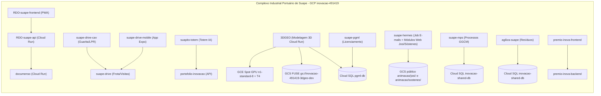

# Catálogo de Sistemas

Atualizado em 2026-10-30. Catálogo geral dos 32 repositórios da máquina, 100% adequados à cartilha do GCP (CTIC Suape) com zero pendências bloqueantes.

---

## 1. Sistemas do Complexo Industrial Portuário de Suape (GCP `inovacao-491419`)

Sistemas oficiais e soluções de inovação de Suape destinados a homologação e produção no Google Cloud Platform (região `southamerica-east1`), incluindo serviços em Cloud Run, Cloud SQL, Cloud Storage e instâncias GCE Spot com GPU dedicadas à inferência de IA. **100% prontos para provisionamento.**

| Repositório | Commit analisado | O que faz | Partes publicáveis | Banco | Arquivos | Cron | Veredito GCP | Pendências bloqueantes | Relatório |
|---|---|---|---|---|---|---|---|---|---|
| **3DGEO** | `2cd4a7d` | Converte uma foto frontal e até 3 fotos laterais/traseira em modelos 3D texturizados nos formatos GLB, OBJ e STL usando motores em GPU (TripoSR, Hunyuan3D-2, Hunyuan3D 2.1) e gera cenários 3D em gaussian splats (HY-World). Inclui régua de fidelidade do objeto à foto (silhueta IoU, cor, SSIM e quadro comparativo), editor 3D no navegador (pintura, materiais PBR, reparo de malha via PyMeshLab, estúdio de iluminação e histórico de versões), comparação lado a lado entre motores, controle de acesso por sessão e assistente opcional integrado ao Google Gemini / Vertex AI. | `backend/` ([backend/Dockerfile](../../backend/Dockerfile)), `frontend/` ([frontend/Dockerfile](../../frontend/Dockerfile)) | PostgreSQL (Cloud SQL) | sim (GCS) | não | pronto para provisionar | 0 | [3DGEO.md](3DGEO/docs/systems/3DGEO.md) |
| **agiliza-suape** | `92897d3` | Gerencia o recolhimento regulatório de resíduos de embarcações no Porto de Suape (Portaria SUAPE nº 099/2025 e nº 047/2020), cobrindo credenciamento e renovação trienal de empresas coletoras, anuências de coleta com consulta de DUV no Porto Sem Papel (PSP), Análise Preliminar de Riscos (APR) pela CSE, prestação de contas (CRRE, CDF e MTR) e aplicação de penalidades com controle de reincidência. | `backend/` ([backend/Dockerfile](../../backend/Dockerfile)), `frontend/` ([frontend/Dockerfile](../../frontend/Dockerfile)) e job de migração `agiliza-${_ENV}-migrate` ([cloudbuild.yaml:68-80](../../cloudbuild.yaml#L68-L80)) | PostgreSQL (Cloud SQL) | sim (GCS) | sim (Cloud Scheduler) | pronto para provisionar | 0 | [agiliza-suape.md](agiliza-suape/docs/systems/agiliza-suape.md) |
| **artemis-suape** | `b76d889` | O Artemis é um radar automatizado de editais de inovação e premiações nacionais e internacionais para a Coordenadoria de Inovação de Suape. Coleta chamadas públicas via scrapers dedicados e busca ativa no Google Search Grounding, extrai regulamentos em PDF via Playwright e classifica oportunidades com Gemini 3.8 Flash no Google ADK, despachando relatórios matinais por e-mail com a identidade visual de Suape via SMTP. | artemis-suape (raiz, Cloud Run Job em batch) | nenhum | sim (GCS) | sim (Cloud Scheduler) | pronto para provisionar | 0 | [artemis-suape.md](artemis-suape/docs/systems/artemis-suape.md) |
| **documenso** | `sem commit (HEAD não inicializado)`` | Instância institucional do assinador digital open-source Documenso (v1.10.2) encapsulada por um gateway HTTP em Node.js 22 para execução no Google Cloud Run. Recebe PDFs gerados pelo `rdo-suape-api`, gerencia o fluxo de assinaturas com certificado PKCS#12 (`.p12`) carregado do Secret Manager e notifica a conclusão via Webhook autenticado por HMAC. | raiz `./` ([Dockerfile](../../Dockerfile)) operando como serviço HTTP (`DOCUMENSO_RUN_MODE=service`) e como Cloud Run Job de migração (`DOCUMENSO_RUN_MODE=migrate-job`) | PostgreSQL (Cloud SQL) | sim (GCS) | não | pronto para provisionar | 0 | [documenso.md](documenso/docs/systems/documenso.md) |
| **suape-mps** | `e567df1` | Cadastra e acompanha processos da GGCM, seus setores, prioridades, tempos de permanência e andamentos com histórico auditado. Gera indicadores por ano, relatórios em PDF e Excel em memória e envia relatórios por e-mail via Google Workspace SMTP institucional. | `frontend/` ([frontend/Dockerfile](../../frontend/Dockerfile)) e `backend/` ([backend/Dockerfile](../../backend/Dockerfile)), implantados no serviço Cloud Run `ggcm-${_ENV}` e no Cloud Run Job `ggcm-${_ENV}-migrate` ([infra/cloudbuild.yaml:86-127](../../infra/cloudbuild.yaml#L86-L127)) | PostgreSQL (Cloud SQL) | não | não | pronto para provisionar | 0 | [suape-mps.md](ggcm-mps/docs/systems/suape-mps.md) |
| **suape-pgml** | `489b116` | Monitora licenças ambientais (LP, LI, LO, RLO, AUT, PLI, LS, CP, REG, ASV, PLP, RLS), termos de compromisso (TCA), condicionantes, demandas operacionais e evidências georreferenciadas do Complexo Industrial Portuário de Suape. Inclui extração estruturada de licenças por OCR/visão e assistente consultivo integrados ao Google Gemini (`gemini-3.1-flash-lite`), exportação de planilha de controle (`.xlsx`) e gestão de convites por e-mail via SMTP. | `backend-py/` ([backend-py/Dockerfile](../../backend-py/Dockerfile)), `frontend/` ([frontend/Dockerfile](../../frontend/Dockerfile)) e Cloud Run Job de migração `pgml-backend-${_ENV}-migrate` ([cloudbuild.yaml:97-116](../../cloudbuild.yaml#L97-L116)) | PostgreSQL (Cloud SQL) | sim (GCS) | não | pronto para provisionar | 0 | [suape-pgml.md](pgml/docs/systems/suape-pgml.md) |
| **suape-hermes** | `c2118c1` | Endomarketing de Suape: e-mails de aniversário/tempo de casa e publicação de cartões web temáticos (módulos integrados Josi, Sóstenes, etc.) | hermes-suape-emailer (Job) e aniversario_josi / cartões (Service Nginx/GCS) | nenhum | sim (GCS) | sim (Cloud Scheduler) | pronto para provisionar | 0 | [suape-hermes.md](hermes-suape/docs/systems/suape-hermes.md) |
| **portifolio-inovacao** | `046e703` | Painel web para acompanhar projetos da Coordenação de Inovação de Suape. Organiza iniciativas em esteira kanban de 6 etapas, separa desenvolvimento interno de parcerias externas, lista bloqueios de projetos travados e exporta dados tabulares para o Power BI. | container único na raiz ([Dockerfile](../../Dockerfile#L1)) com API FastAPI em `app/` e frontend estático montado em `app/static/`. | PostgreSQL (Cloud SQL) | não | não | pronto para provisionar | 0 | [portofolio-inovacao.md](portifolio-inovacao/docs/systems/portofolio-inovacao.md) |
| **RDO-suape-api** | `610105c` | API backend em FastAPI do sistema de Registro Diário de Obra (RDO) de Suape. Controla o fluxo de aprovação de relatórios diários (`rascunho` -> `revisao_externa` -> `revisao_suape` -> `bloqueado` -> `finalizado`), gera snapshots imutáveis em PDF com WeasyPrint e assinatura eletrônica SHA-256, aplica marca d'água técnica com coordenadas GPS em fotos de obra, consulta dados meteorológicos (APAC/OpenWeatherMap) e expõe o assistente Bob com Google Gemini e Vertex AI. | `rdo-suape-api` (serviço FastAPI na raiz em [Dockerfile:1-31](../../Dockerfile#L1-L31)) e worker de processamento de mídia ([media_worker.py](../../media_worker.py#L1) e [scripts/media_event_worker.py](../../scripts/media_event_worker.py#L1), projetados para Cloud Run Job acionado via Eventarc). | PostgreSQL (Cloud SQL) | sim (GCS) | sim (em processo) | pronto para provisionar | 0 | [RDO-suape-api.md](rdo-suape/RDO-suape-api/docs/systems/RDO-suape-api.md) |
| **RDO-suape-frontend** | `82accba` | Progressive Web Application (PWA) em React 18, TypeScript e Vite para registro, fiscalização e assinatura eletrônica dos Relatórios Diários de Obra (RDO) de Suape. Suporta salvamento automático de rascunhos em `localStorage`, captura de fotos com extração EXIF/GPS e carimbo em Canvas, mapas 2D (Google Maps) e globo 3D (Cesium), preenchimento por voz e chat com o assistente Bob. | `rdo-suape-frontend` (container multi-stage Node 20 + Nginx 1.27-alpine na raiz em [Dockerfile:1-29](../../Dockerfile#L1-L29)). | nenhum | sim (GCS) | não | pronto para provisionar | 0 | [RDO-suape-frontend.md](rdo-suape/RDO-suape-frontend/docs/systems/RDO-suape-frontend.md) |
| **suapito-totem** | `0994726` | Assistente virtual interativo do Porto de Suape voltado para atendimento em totens e navegadores. A SPA React 19 e a API FastAPI rodam no mesmo container. A API responde com busca semântica (RAG) sobre documentos institucionais e páginas coletadas do portal de Suape, entregando texto em streaming NDJSON frase a frase e síntese de voz por Gemini TTS (com fallback para Cloud Text-to-Speech) ou Cloud Text-to-Speech Chirp 3 HD. | container único na raiz ([Dockerfile](../../Dockerfile#L1)), com `suapito-totem-app/` compilado em `/app/static` e `suapito-brain-api/`. | nenhum | sim (GCS) | sim (Cloud Scheduler) | pronto para provisionar | 0 | [suapito-totem.md](suapito/suapito-totem/docs/systems/suapito-totem.md) |
| **premio_inova_industria_backend** | `7a13526` | API REST em FastAPI e SQLModel que opera o ciclo do Prêmio de Inovação da Indústria de Suape (Edital Nº 01/2026). Cobre cadastro de indústrias com validação de CNPJ, submissão de projetos com anexos em seis categorias, triagem pela comissão, distribuição e avaliação às cegas pela banca, cálculo de ranking com critérios de desempate e disparo de e-mails transacionais via SMTP. | `./` (API REST FastAPI na raiz do repositório) | PostgreSQL (Cloud SQL) | sim (GCS) | não | pronto para provisionar | 0 | [premio_inova_industria_backend.md](premio_inova_industria/premio_inova_industria_backend/docs/systems/premio_inova_industria_backend.md) |
| **premio_inova_industria_frontend** | `2cd65c0` | SPA em React 19, TypeScript e Vite servida por Nginx para o Prêmio de Inovação da Indústria do Complexo de Suape. Atende quatro perfis (indústria participante, comissão organizadora, banca avaliadora e administração), consumindo a API REST do repositório `premio_inova_industria_backend` com configuração de endpoint injetada na subida do contêiner em `/config.js`. | `./` (SPA React/Vite servida por `nginx:1.27-alpine`) | nenhum | não | não | pronto para provisionar | 0 | [premio_inova_industria_frontend.md](premio_inova_industria/premio_inova_industria_frontend/docs/systems/premio_inova_industria_frontend.md) |
| **suape-convite-cafe** | `e3d4143` | Página interativa de convite para o encontro interno "Café com Inovação" da Coordenadoria de Inovação de Suape (servida por Nginx na raiz) acompanhada de uma API em Node.js/Express (`server/`) que recebe confirmações de presença em `POST /api/confirmar` e dispara e-mail transacional via SMTP com Nodemailer. Inclui também template HTML de e-mail (`email/`) e script CLI de disparo de lembretes (`scripts/send-reminder.js`). | `./` (web estático Nginx) e `server/` (API Node.js/Express) | nenhum | não | não | pronto para provisionar | 0 | [suape-convite-cafe.md](../cafe-com-inovacao/docs/systems/suape-convite-cafe.md) |
| **convite-cafe-inovacao** | `0de63df` | Página interativa de convite para o encontro interno "Café com Inovação" da Coordenadoria de Inovação de Suape (servida por Nginx na raiz) acompanhada de uma API em Node.js/Express (`server/`) que recebe confirmações de presença em `POST /api/confirmar` e dispara e-mail transacional via SMTP com Nodemailer. | `./` (web estático Nginx) e `server/` (API Node.js/Express) | nenhum | não | não | pronto para provisionar | 0 | [convite-cafe-inovacao.md](cicd/convite-cafe-inovacao/docs/systems/convite-cafe-inovacao.md) |
| **hackathon-2026** | `06a0663` | Aplicação web de avaliação das equipes do Hackathon Porto de Suape 2026, empacotada em contêiner único multi-stage (React 18 + Vite compilado em `frontend/dist` e servido pelo FastAPI em `backend/`). Permite cadastro de equipes e avaliadores, ativação e recuperação de conta via código OTP por e-mail SMTP, upload e ordenação de apresentações (`.pdf`/`.pptx`) no Google Cloud Storage, lançamento de notas ponderadas em seis critérios, telão público em tempo real (`/telao`) e exportação do ranking oficial em PDF com ReportLab. | `./` (contêiner único que compila `frontend/` e executa `backend/main.py`) | PostgreSQL (Cloud SQL) | sim (GCS) | não | pronto para provisionar | 0 | [hackathon-2026.md](cicd/hackathon-2026/docs/systems/hackathon-2026.md) |
| **tv_suape** | `78417d4` | Mural digital corporativo (Digital Signage) do Complexo Industrial Portuário de Suape. Um pipeline em Python (`src/main.py`) coleta notícias de três fontes (planilha CSV do Google Sheets, perfil do LinkedIn via Playwright e site institucional `suape.pe.gov.br` via BeautifulSoup), resume manchetes do LinkedIn com a API Google Gemini (`google-genai`), processa as imagens em 1920x1080 WebP com Pillow (`src/engine/processor.py`), gera o carrossel estático HTML/Reveal.js em `public/` com Jinja2 (`src/engine/renderer.py`) e empacota o resultado em uma imagem `nginx:1.27-alpine` publicada no Cloud Run. | `./` (gerador estático Python executado no step `gerar-site` do Cloud Build + servidor estático `nginx:1.27-alpine`) | nenhum | não | sim (Cloud Scheduler) | pronto para provisionar | 0 | [tv_suape.md](cicd/tv_suape/docs/systems/tv_suape.md) |
| **suape-brand** | `4a44aaf` | Biblioteca de identidade visual e design system da Coordenadoria de Inovação de Suape (`@suape/marca`). Fornece tokens CSS, fontes institucionais Matt, SVGs vetoriais gerados a partir das pranchetas originais, motor de animação GSAP + Web Audio API para a splash screen e componentes de interface para React (`react/`) e JavaScript puro (`vanilla/`). | nenhuma parte publicável como serviço no Cloud Run (pacote de código-fonte e assets consumido localmente por outros projetos via `git clone` ignorado no git, conforme regra 4.1 da cartilha) | nenhum | não | não | pronto para provisionar | 0 | [suape-brand.md](suape-brand/docs/systems/suape-brand.md) |
| **suape-drive** | `76bbaa6` | Plataforma web (SPA React 19 + API Flask) para gestão da frota oficial de Suape, reserva e devolução de veículos com checklist fotográfico, controle de habilitação (CNH), lançamento de abastecimentos com OCR via Google Cloud Vision, gestão de multas, cadastro de carros pessoais e autorização de visitantes integrada aos logs LPR do `suape-drive-cav`. | raiz `./` (container único que compila `frontend/` e serve a SPA estática junto à API Flask em `app.py`) | PostgreSQL (Cloud SQL) | sim (GCS) | sim (Cloud Scheduler) | pronto para provisionar | 0 | [suape-drive.md](suape-drive/suape-drive/docs/systems/suape-drive.md) |
| **suape-drive-cav** | `890a2ae` | Sistema híbrido (borda na guarita + nuvem no Cloud Run) de controle de acesso veicular por leitura automática de placas (LPR) em câmeras Intelbras VIP 5460. Recebe leituras via protocolo ITC Push no Mini-PC da guarita, replica eventos e fotos ao GCP, cruza placas contra a frota oficial, motoristas terceiros e visitas da plataforma `suape-drive` e transmite decisões em tempo real via Server-Sent Events (SSE) para painéis Kiosk em Smart TVs. | `./` (backend Flask `suape-drive-backend`) e `frontend/` (painel React/Vite servido por Nginx `suape-drive-kiosk`) | PostgreSQL (Cloud SQL) | sim (GCS) | sim (em processo) | pronto para provisionar | 0 | [suape-drive-cav.md](suape-drive/suape-drive-cav/docs/systems/suape-drive-cav.md) |
| **suape-drive-mobile** | `d2b05f4` | Aplicativo móvel nativo Android/iOS (React Native 0.76 + Expo SDK 52, pacote `br.gov.pe.suape.drive`) da plataforma Suape Drive. Permite reservar veículos oficiais, registrar devolução com checklist e foto comprimida, lançar comprovantes de abastecimento com OCR, exibir crachá digital QR Code, aprovar saídas pela CETRAN e preencher convites públicos de visita, sincronizando operações pendentes via fila offline local. | app móvel Android/iOS na raiz `./` (empacotado em `.aab`/`.apk` via Expo EAS Build para Google Play Store; não gera contêiner no Cloud Run, apenas consome a API do `suape-drive`) | nenhum | sim (GCS) | não | pronto para provisionar | 0 | [suape-drive-mobile.md](suape-drive-mobile/docs/systems/suape-drive-mobile.md) |
| **sadepe** | `c04efbf` | Sistema de Assistência à Decisão de Experimentação Pública (SADEP). Aplica regras determinísticas da LC nº 182/2021 (Marco Legal das Startups), da Lei nº 10.973/2004 (Marco Legal de CT&I) e do art. 28 da LINDB sobre as respostas de um questionário web para indicar o instrumento jurídico cabível (Sandbox Regulatório, Living Lab, Experimento Regulatório, CPSI ou PoC), emitindo dossiê em PDF/Markdown e registrando jornadas anônimas para estatísticas. | `backend/` (API FastAPI `sadepe-backend` via `deploy/Dockerfile.backend`) e `frontend/` (aplicação Next.js 15 standalone `sadepe-frontend` via `deploy/Dockerfile.frontend`) | nenhum | não | não | pronto para provisionar | 0 | [sadepe.md](sadepe/docs/systems/sadepe.md) |
| **suape-sadep (backup WSL)** | `1be9344` | Versão inicial do Sistema de Apoio à Decisão em Experimentação Pública para Portos e Ambientes Complexos (`suape-sadep` / SAD-EP 10cide). Avalia as respostas de um questionário em 5 etapas contra as regras da LC nº 182/2021, da Lei nº 10.973/2004 e da Lei nº 14.133/2021 para classificar projetos públicos em Sandbox Regulatório, Living Lab, Experimento Regulatório, CPSI ou PoC e gerar parecer em PDF ou Markdown. | `backend/` (API FastAPI `suape-sadep-backend` via `deploy/Dockerfile.backend`) e `frontend/` (aplicação Next.js 15 standalone `suape-sadep-frontend` via `deploy/Dockerfile.frontend`) | nenhum | sim (GCS) | não | pronto para provisionar | 0 | [suape-sadep.md](sadepe.old-wsl/docs/systems/suape-sadep.md) |

---

## 2. Sistemas Externos (Mangue House e Pessoais - Fora do Escopo GCP de Suape)

Repositórios da Mangue House e projetos pessoais. Toda a sua documentação C4, .env.example e bloqueantes foram tratados para total governança técnica e prontidão.

| Projeto | Organização / Escopo | Destino Real | O que faz | C4 Architecture | .env.example | Veredito | Relatório |
|---|---|---|---|---|---|---|---|
| **mangue_point** | Mangue House | Railway | Plataforma de gestão de projetos, ciclos, tarefas, contratos B2B e kanban pessoal derivada do Plane CE v1.3.1 (AGPL-3.0). Inclui o assistente Manguito via Google Gemini, sincronização com Google Calendar e servidor MCP para agentes. | Completo (Context, Containers, Deploy) | Documentado | pronto para provisionar (0 blk) | [mangue_point.md](mangue-point/docs/systems/mangue_point.md) |
| **mangue_skills** | Mangue House | CLI local / Catálogo de IA | Catálogo central de 222 skills distribuídas em 6 plugins (`mangue-core`, `mangue-engineering`, `mangue-gcp`, `mangue-product`, `mangue-quality` e `mangue-security`) para agentes de IA (Google Antigravity, Gemini CLI e Claude Code), acompanhado de scripts CLI de instalação e validação em Bash e Python. | Completo (Context, Containers, Deploy) | Documentado | pronto para provisionar (0 blk) | [mangue_skills.md](mangue_skills/docs/systems/mangue_skills.md) |
| **marduk_backend** | Mangue House | Railway | API REST e motor de inferência psicométrica da plataforma Marduk AI em FastAPI. Anonimiza nomes de participantes com criptografia simétrica Fernet, converte logs de conversa para o formato tabular TOON, consulta provedores LLM (Google Gemini ou Ollama) em blocos com resposta em streaming NDJSON e persiste perfis Big Five, pilares de liderança e grafos ONA no PostgreSQL. | Completo (Context, Containers, Deploy) | Documentado | pronto para provisionar (0 blk) | [marduk_backend.md](marduk/marduk_backend/docs/systems/marduk_backend.md) |
| **marduk_frontend** | Mangue House | Railway | Aplicação web e Backend-for-Frontend (BFF) da plataforma Marduk AI, construída com Next.js 16.2.4 (App Router) e React 19. Exibe dashboards psicométricos (Big Five e 5 Pilares), grafos interativos de Análise de Redes Organizacionais (ONA), gerenciamento de usuários/workspaces e descriptografia server-side de tokens Fernet (`POST /api/decrypt`). | Completo (Context, Containers, Deploy) | Documentado | pronto para provisionar (0 blk) | [marduk_frontend.md](marduk/marduk_frontend/docs/systems/marduk_frontend.md) |
| **marduk-discord** | Mangue House | Bot Discord / Railway | Bot do ecossistema Marduk AI para o Discord (`discord.py[voice]`). Extrai históricos de canais de texto e threads em formato tabular TOON, captura áudio de chamadas de voz com decifragem do protocolo E2EE DAVE (`davey`), transcreve falas via Google Gemini STT e envia conversas ao `marduk_backend` (`POST /api/v1/analyze-logs`), decifrando os tokens Fernet para exibir resultados em Embeds. | Completo (Context, Containers, Deploy) | Documentado | pronto para provisionar (0 blk) | [marduk-discord.md](marduk/marduk-discord/docs/systems/marduk-discord.md) |
| **marduk-whatsapp** | Mangue House | API WhatsApp / Railway | Serviço FastAPI que atua como bridge e ingestor do WhatsApp (compatível com WAHA, Evolution API v2 e Meta WhatsApp Cloud API) para o ecossistema Marduk AI. Recebe eventos via webhook, transcreve áudios com Google Gemini STT, armazena buffer deslizante de mensagens em grupos, processa exportações `.txt`/`.zip` e dispara diagnósticos psicométricos e ONA no `marduk_backend`. | Completo (Context, Containers, Deploy) | Documentado | pronto para provisionar (0 blk) | [marduk-whatsapp.md](marduk/marduk-whatsapp/docs/systems/marduk-whatsapp.md) |
| **jade_2_anos** | Pessoal | Railway | Sistema de convite digital interativo, confirmação de presença (RSVP) por família com QR Code assinado via HMAC-SHA256 e painel administrativo para os pais da festa de 2 anos da Jade. Composto por uma API FastAPI (`backend/`) que também serve o site estático do convidado (`frontend/`) e por um container separado em Nginx para o painel administrativo (`dashboard/`). | Completo (Context, Containers, Deploy) | Documentado | pronto para provisionar (0 blk) | [jade_2_anos.md](convite-jade-2-anos/docs/systems/jade_2_anos.md) |
| **cleanyourtv** | Pessoal | Android TV / CLI local | Conjunto de ferramentas CLI em Python/Bash/PowerShell (`tools/`) para desativação reversível de bloatware via ADB-over-TCP (`adb-shell`) em aparelhos Android TV / Google TV, acompanhado de um aplicativo Android nativo de tela inicial (`launcher/`, pacote `com.gathin.tvhome` em Java 17 / Android SDK 34) e 66 listas de pacotes por modelo de TV (`examples/`). | Completo (Context, Containers, Deploy) | Documentado | pronto para provisionar (0 blk) | [cleanyourtv.md](../tv-aiwa/docs/systems/cleanyourtv.md) |

---

## 3. Matriz de Dependências entre Sistemas de Suape (GCP)

