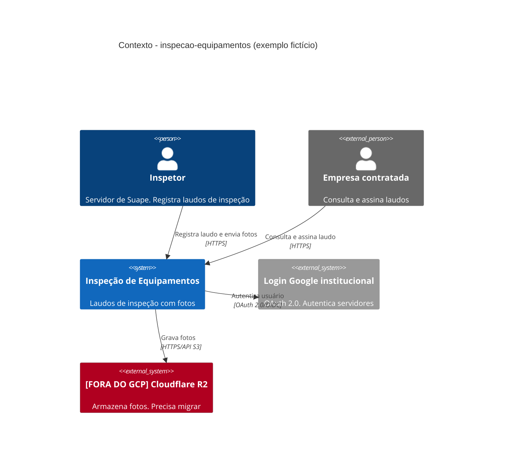
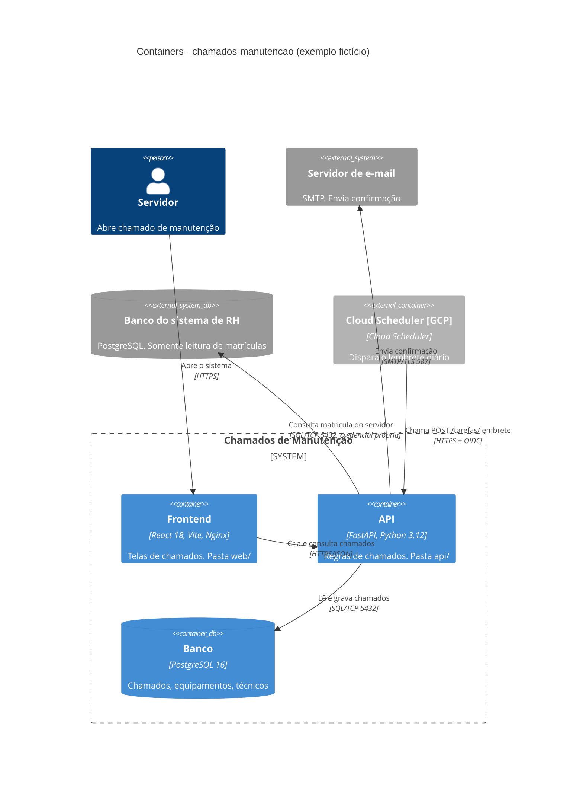
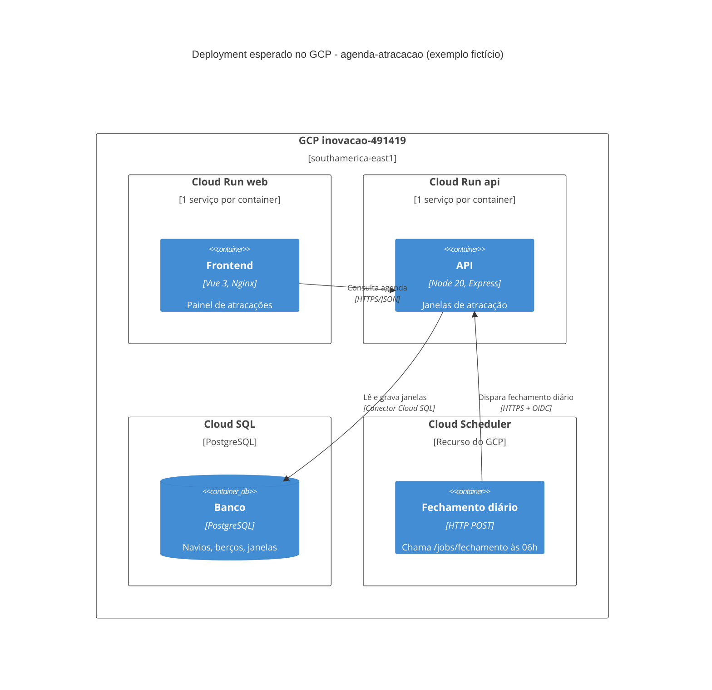

# Modelos dos arquivos, com exemplos de Suape

MANDATORY no passo 3. Os exemplos são **fictícios** e servem só para mostrar a forma; não copie elementos que o repositório não tem.

## Cabeçalho e rodapé

```markdown
# C4 nível N: <título> - <nome-do-repositório>

Gerado a partir do código. Fontes principais: [package.json](../../package.json), [api/Dockerfile](../../api/Dockerfile).
```

No fim de `c4-containers.md` (e **só** nele):

```markdown
## Pendências para o provisionamento
| Pendência | Bloqueia? | Evidência | Correção esperada |
|---|---|---|---|
| Fotos gravadas no Cloudflare R2 | Sim | [web/vite.config.ts](../../web/vite.config.ts) | Trocar por GCS, bucket por variável |
| `SECRET_KEY` com valor padrão no código | Sim | [api/config.py](../../api/config.py) | Falhar na inicialização sem a variável |
| Servidor com porta literal no `CMD`, ignora `PORT` | Não | [api/Dockerfile](../../api/Dockerfile) | Ler `$PORT` |
| Backend na raiz + `frontend/` | Não | estrutura do repositório | Mover para `api/` e `web/` |
| `REDIS_URL` no `.env.example`, não lida pelo código | Não | [.env.example](../../.env.example) | Remover do exemplo ou implementar |
| `docs/systems/<repo>.md` ausente (antes e depois desta execução) | Sim | estrutura do repositório | Rodar /scan-systems |
| `README.md` sem como rodar os testes | Sim | [README.md](../../README.md) | Acrescentar o comando de testes |
| `PAYMENTS_TOKEN` lida em `api/pay.py`, sem documentação | Sim | [api/pay.py](../../api/pay.py) | Documentar o nome na tabela de variáveis |

## Perguntas ao desenvolvedor
- Disponibilidade: horário comercial ou 24x7?
```
Sem pendências, escreva "Nenhuma encontrada na varredura" em vez de omitir a seção.

No fim de `c4-context.md` e `c4-deployment.md`, só:

```markdown
Pendências e perguntas: ver [c4-containers.md](c4-containers.md#pendências-para-o-provisionamento).
```

## c4-context.md (exemplo: inspeção de equipamentos)



Depois do diagrama, tabela "Atores e sistemas externos": Elemento | Tipo | Evidência (link).

## c4-containers.md (exemplo: chamados de manutenção)



Tabela obrigatória, uma linha por container:

| Container | Pasta | Dockerfile | Tecnologia | Porta | Banco | Integrações | /health |
|---|---|---|---|---|---|---|---|
| API | [api/](../../api/) | [api/Dockerfile](../../api/Dockerfile) | FastAPI | lê `PORT` | PostgreSQL | SMTP | `/health` em [api/main.py](../../api/main.py) |

Na coluna Porta, escreva como o processo recebe a porta: "lê `PORT`" ou "literal 8080 no CMD (pendência)". Na coluna /health, o caminho real: `/health`, ou `/livez` + `/readyz`; `/healthz` vira pendência.

**Um container com as duas pastas** (backend servindo o front compilado): uma linha só, Pasta `api/` + `web/`, e a descrição diz "API e frontend compilado na mesma imagem".

Tabela de variáveis, só nomes e só as que o código lê (variável que existe apenas no `.env.example` vai para as pendências, não para cá):

| Variável | Container | Tipo | Evidência |
|---|---|---|---|
| DATABASE_URL | api | runtime, segredo | [api/config.py](../../api/config.py) |
| VITE_API_URL | web | build-time, rebuild por ambiente | [web/src/api.ts](../../web/src/api.ts) |

## c4-deployment.md (exemplo: agenda de atracação no porto)



Tabela "O que o projeto espera do GCP":

| Recurso | Para quê | Evidência | Observação |
|---|---|---|---|
| Cloud Run (1 por container) | web, api | Dockerfiles | min-instances depende da disponibilidade |
| Cloud SQL PostgreSQL | dados | [api/prisma/schema.prisma](../../api/prisma/schema.prisma) | Migrações rodam antes do deploy |
| GCS | uploads | link do código de upload | Só se houver upload |
| Secret Manager | variáveis runtime/segredo | [c4-containers.md](c4-containers.md) | Só nomes |
| Cloud Scheduler | rota chamada por agendamento | link da rota | Frequência e autenticação (OIDC ou token). Se o agendamento não está no repositório: "A confirmar com o dev" |
| Disponibilidade | horário comercial (escala a zero, aceita cold start) ou 24x7 (instância mínima ligada) | README ou resposta do dev | Nunca suponha |

Se o projeto usa recurso que o GCP não oferece no modelo acima (ex.: WebSocket de longa duração, fila Redis), registre como linha separada com "A confirmar com a infra".

## c4-components-<parte>.md

Só quando a parte tem fluxo interno que o container não explica. Use `C4Component` dentro de `Container_Boundary`, cada componente ligado a um módulo real (rota, serviço, worker). Não desenhe uma caixa por arquivo.
